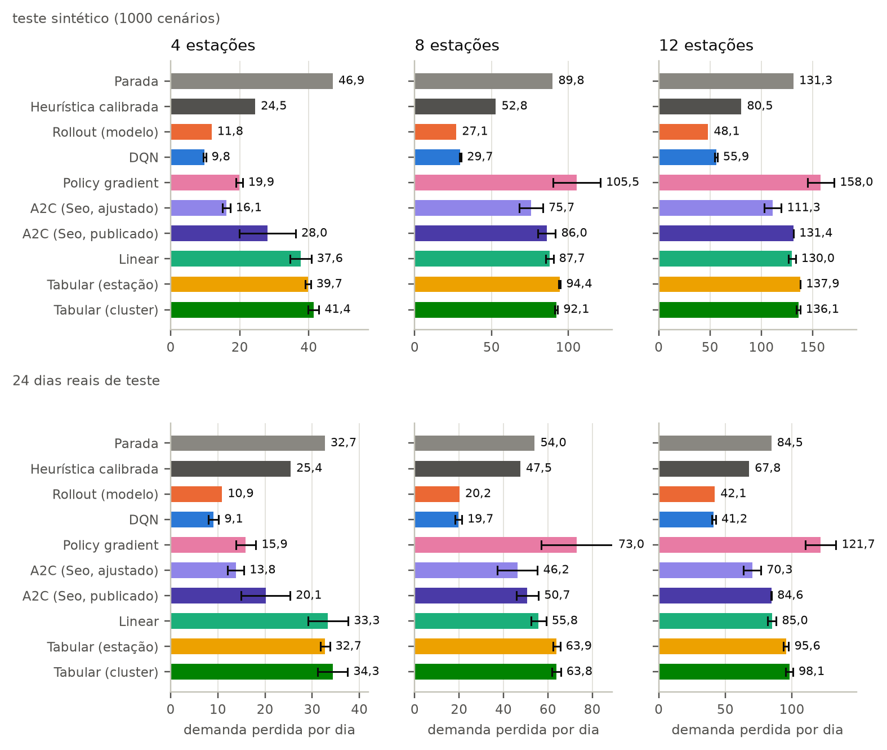
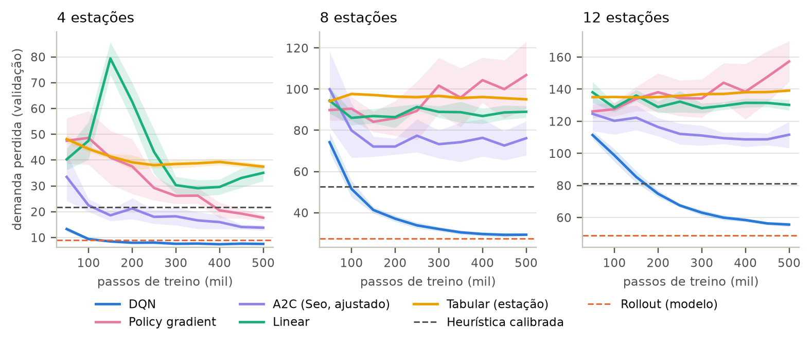
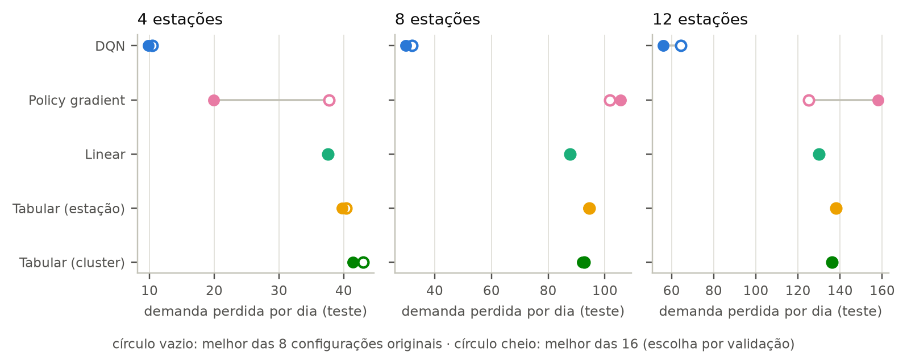
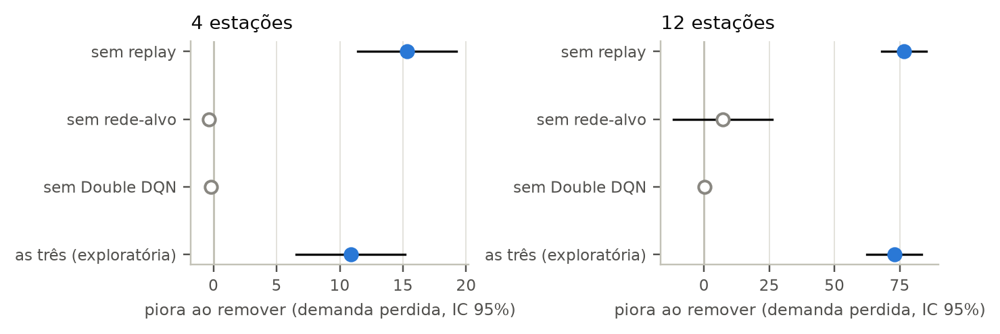
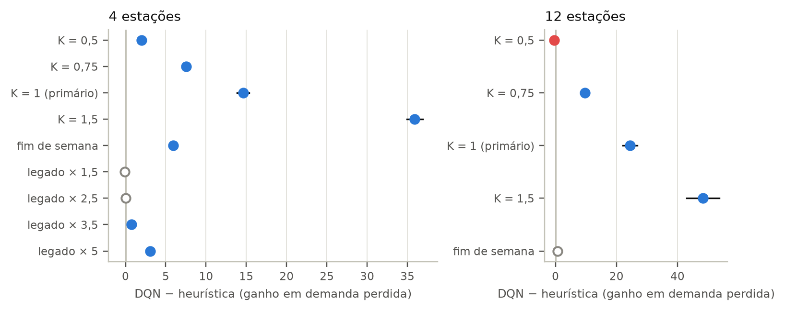

# 06 — Resultados (gerado por `scripts/25_make_report.py`; nenhum número digitado à mão)

> Demanda perdida por dia (menor é melhor), média de 10 sementes de treino com IC 95% t, salvo indicação. Referência de heurística e rollout de cabeçalho escolhidos em validação. Fonte: `runs/*.jsonl`; configurações e desvios: `DESVIOS.md`.

## 1. Resultado principal

| escala | parada | heurística calibrada | rollout (h, K) | DQN [IC95%] | redução vs heurística | DQN − rollout [IC95%] | dias reais: heurística | rollout | DQN |
|---|---|---|---|---|---|---|---|---|---|
| 4 est. | 46,9 | 24,5 | 11,8 (3, 64) | 9,8 [9,4; 10,2] | 60% | 2,1 [1,7; 2,5] | 25,4 | 10,9 | 9,1 |
| 8 est. | 89,8 | 52,8 | 27,1 (3, 64) | 29,7 [29,0; 30,3] | 44% | -2,6 [-3,3; -2,0] | 47,5 | 20,2 | 19,7 |
| 12 est. | 131,3 | 80,5 | 48,1 (3, 64) | 55,9 [54,7; 57,1] | 30% | -7,8 [-9,0; -6,6] | 67,8 | 42,1 | 41,2 |

(DQN − rollout > 0: o DQN perde menos demanda que o rollout.)

## 2. Todos os métodos

| método | 4 est. (teste) | 8 est. (teste) | 12 est. (teste) | 4 est. (dias reais) | 8 est. (dias reais) | 12 est. (dias reais) |
|---|---|---|---|---|---|---|
| Parada | 46,9 | 89,8 | 131,3 | 32,7 | 54,0 | 84,5 |
| Heurística calibrada | 24,5 | 52,8 | 80,5 | 25,4 | 47,5 | 67,8 |
| Rollout (modelo) | 11,8 | 27,1 | 48,1 | 10,9 | 20,2 | 42,1 |
| DQN | 9,8 [9,4; 10,2] | 29,7 [29,0; 30,3] | 55,9 [54,7; 57,1] | 9,1 [8,0; 10,2] | 19,7 [18,2; 21,2] | 41,2 [39,7; 42,8] |
| Policy gradient | 19,9 [18,9; 20,8] | 105,5 [90,1; 120,8] | 158,0 [144,9; 171,0] | 15,9 [13,8; 18,1] | 73,0 [56,9; 89,1] | 121,7 [110,3; 133,1] |
| A2C (Seo, ajustado) | 16,1 [15,0; 17,2] | 75,7 [68,0; 83,4] | 111,3 [103,1; 119,5] | 13,8 [12,1; 15,5] | 46,2 [37,2; 55,3] | 70,3 [63,8; 76,7] |
| A2C (Seo, publicado) | 28,0 [19,8; 36,2] | 86,0 [80,3; 91,7] | 131,4 [131,3; 131,4] | 20,1 [14,9; 25,3] | 50,7 [45,7; 55,8] | 84,6 [84,5; 84,8] |
| Linear | 37,6 [34,5; 40,7] | 87,7 [85,3; 90,2] | 130,0 [126,6; 133,4] | 33,3 [29,1; 37,6] | 55,8 [52,3; 59,2] | 85,0 [81,7; 88,2] |
| Tabular (estação) | 39,7 [38,9; 40,5] | 94,4 [93,9; 94,9] | 137,9 [137,8; 138,1] | 32,7 [31,8; 33,7] | 63,9 [62,3; 65,5] | 95,6 [93,6; 97,6] |
| Tabular (cluster) | 41,4 [39,8; 42,9] | 92,1 [91,2; 93,0] | 136,1 [134,3; 137,8] | 34,3 [31,2; 37,5] | 63,8 [61,9; 65,8] | 98,1 [95,5; 100,8] |

## 3. Efeito de estender a busca de hiperparâmetros (P1)

| escala | DQN: 8 configs | DQN: 16 configs | ganho |
|---|---|---|---|
| 4 est. | 10,4 | 9,8 | 0,7 |
| 8 est. | 32,0 | 29,7 | 2,3 |
| 12 est. | 64,3 | 55,9 | 8,4 |

## 4. Ablação do DQN (P2)

| escala | variante | piora ao remover [IC95%] | n |
|---|---|---|---|
| 4 est. | sem replay | 15,32 [11,43; 19,22] | 10 |
| 4 est. | sem rede-alvo | -0,35 [-0,78; 0,07] | 10 |
| 4 est. | sem Double DQN | -0,18 [-0,55; 0,20] | 10 |
| 4 est. | as três (exploratória) | 10,85 [6,56; 15,15] | 10 |
| 12 est. | sem replay | 76,63 [68,12; 85,14] | 10 |
| 12 est. | sem rede-alvo | 7,16 [-11,70; 26,01] | 10 |
| 12 est. | sem Double DQN | 0,24 [-1,38; 1,86] | 10 |
| 12 est. | as três (exploratória) | 72,94 [62,39; 83,49] | 10 |

## 5. Sensibilidade do simulador (P3; n = 5, exploratória)

| escala | variante | parada | heurística | DQN | DQN − heurística [IC95%] |
|---|---|---|---|---|---|
| 4 est. | K = 0,5 | 7,3 | 2,6 | 0,6 | 1,99 [1,94; 2,04] |
| 4 est. | K = 0,75 | 23,5 | 10,6 | 3,0 | 7,56 [7,32; 7,79] |
| 4 est. | K = 1 (primário) | 46,9 | 24,5 | 9,9 | 14,61 [13,87; 15,34] |
| 4 est. | K = 1,5 | 105,1 | 71,4 | 35,5 | 35,89 [34,92; 36,87] |
| 4 est. | fim de semana | 17,5 | 8,5 | 2,6 | 5,93 [5,52; 6,33] |
| 4 est. | legado × 1,5 | 0,4 | 0,1 | 0,2 | -0,10 [-0,24; 0,04] |
| 4 est. | legado × 2,5 | 1,7 | 0,4 | 0,3 | 0,03 [-0,22; 0,29] |
| 4 est. | legado × 3,5 | 3,4 | 1,1 | 0,4 | 0,75 [0,46; 1,03] |
| 4 est. | legado × 5 | 7,6 | 3,9 | 0,8 | 3,06 [2,97; 3,14] |
| 12 est. | K = 0,5 | 20,9 | 6,8 | 7,3 | -0,47 [-0,76; -0,17] |
| 12 est. | K = 0,75 | 61,3 | 30,6 | 21,0 | 9,62 [8,50; 10,75] |
| 12 est. | K = 1 (primário) | 131,3 | 80,5 | 56,0 | 24,46 [22,09; 26,82] |
| 12 est. | K = 1,5 | 327,4 | 259,2 | 210,9 | 48,30 [42,92; 53,68] |
| 12 est. | fim de semana | 39,8 | 18,3 | 17,7 | 0,63 [-0,10; 1,36] |

## 6. Limitações a declarar

- Simulador sem roteamento: todo deslocamento custa 1 intervalo; ocupação inicial dos dias reais desconhecida (50% ± 2); o modelo de Poisson superestima a dificuldade vs dias reais.
- O rollout usa o modelo verdadeiro da demanda; o DQN aprende só de amostras. O melhor rollout estava no limite da grade (h, K).
- O A2C é uma adaptação (entrada e ação do nosso simulador); a variante "publicado" não foi ajustada e a "ajustado" usa o mesmo orçamento (16 configs, 2 sementes de ajuste) dos demais aprendizes; nenhuma prova que o método original falha no problema de Seo et al.
- Sensibilidade: aprendizes sem reajuste por variante, 5 sementes. Dados Tembici: ainda sem hold-out (janela < 4 semanas completas).
